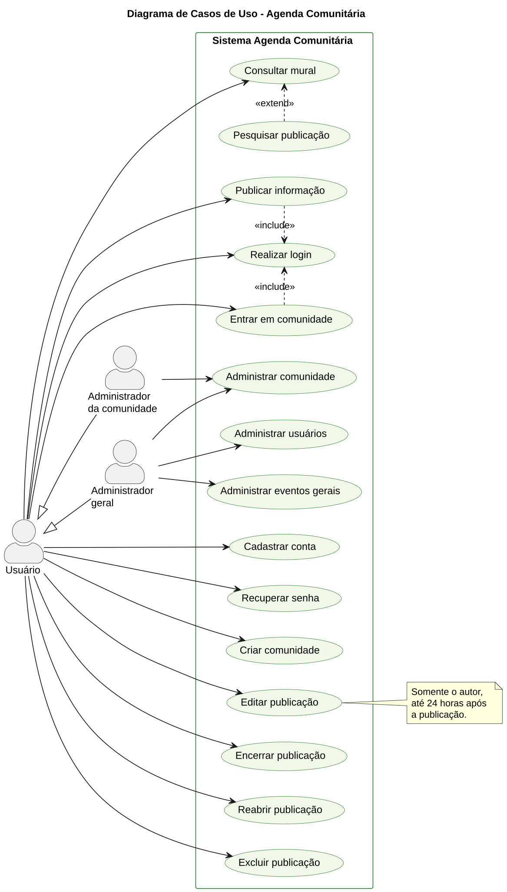
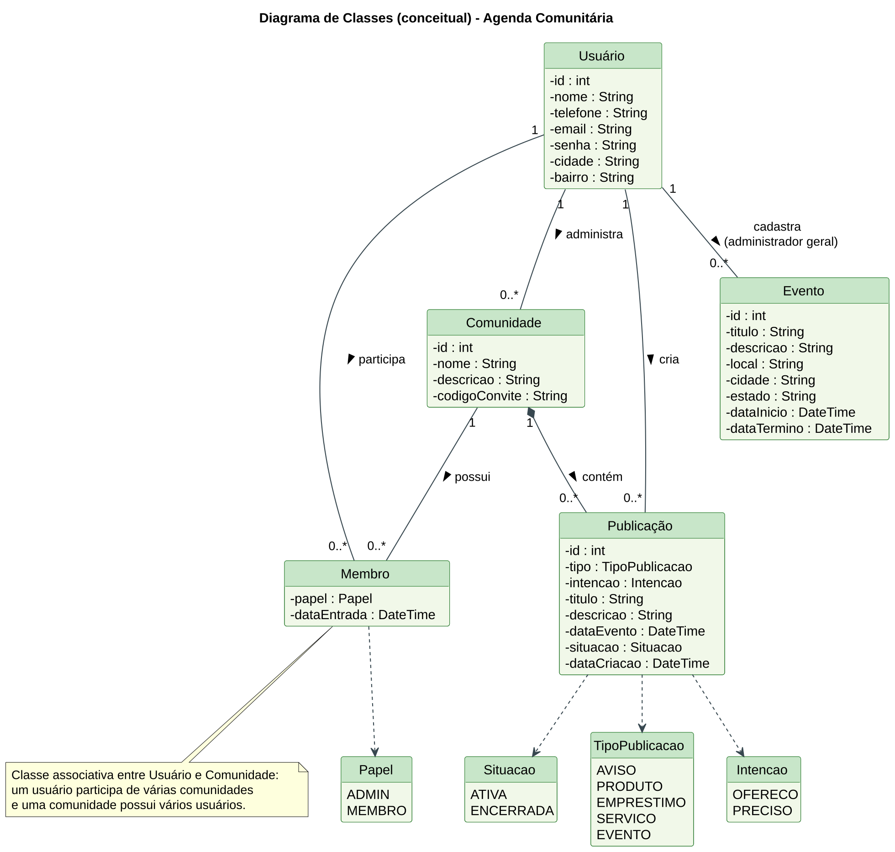
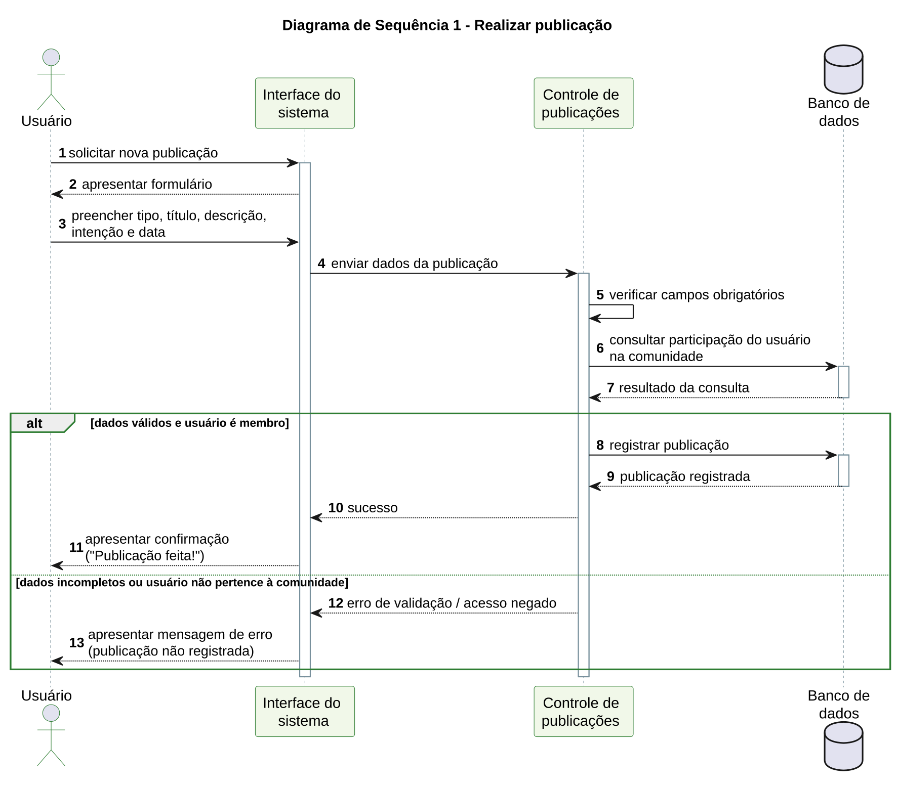
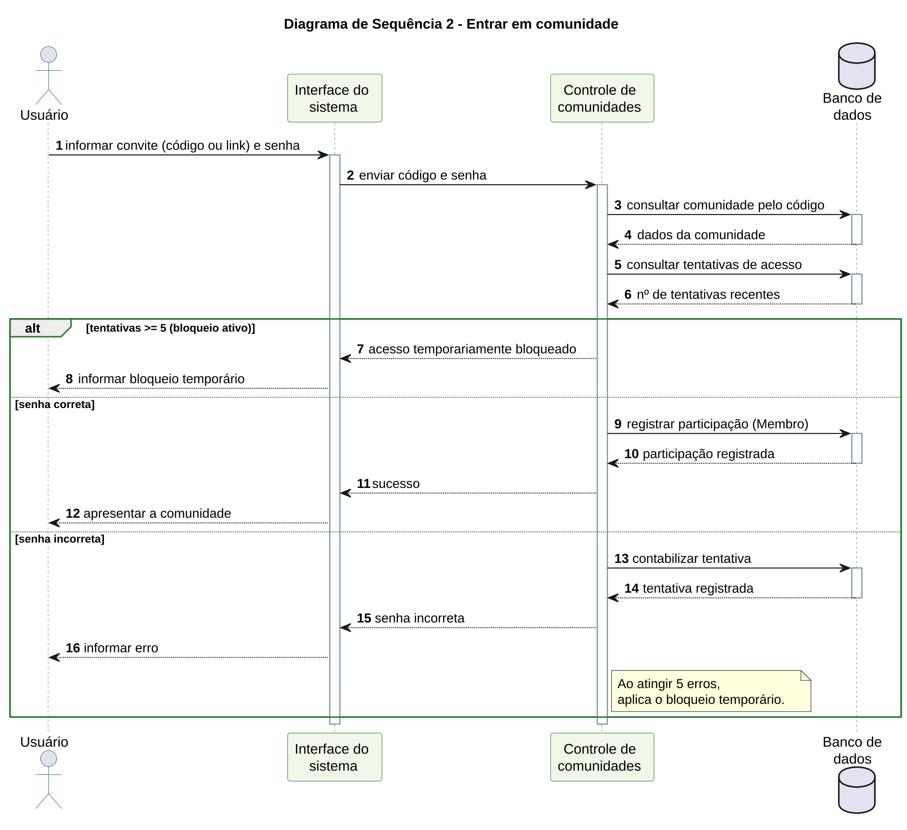

# 📐 Modelagem UML – Agenda Comunitária

A modelagem UML representa o funcionamento do sistema de forma visual e consistente com os requisitos especificados. Foram utilizados três tipos de diagramas: **casos de uso**, **classes** e **sequência**.

## Sumário

- [6.1 Diagrama de casos de uso](#61-diagrama-de-casos-de-uso)
- [6.2 Especificação dos casos de uso críticos](#62-especificação-dos-casos-de-uso-críticos)
  - [UC01 – Realizar publicação](#uc01--realizar-publicação)
  - [UC02 – Entrar em comunidade](#uc02--entrar-em-comunidade)
  - [UC03 – Gerenciar publicação](#uc03--gerenciar-publicação)
- [6.3 Diagrama de classes](#63-diagrama-de-classes)
- [6.4 Diagramas de sequência](#64-diagramas-de-sequência)
  - [Diagrama 1 – Realizar publicação](#diagrama-1--realizar-publicação)
  - [Diagrama 2 – Entrar em comunidade](#diagrama-2--entrar-em-comunidade)
- [6.5 Consistência entre os diagramas](#65-consistência-entre-os-diagramas)
- [Como editar os diagramas](#como-editar-os-diagramas)

---

## 6.1 Diagrama de casos de uso

Representa os atores **Usuário**, **Administrador da comunidade** e **Administrador geral**, a fronteira do sistema e as funcionalidades que cada um utiliza. Os dois administradores são especializações do Usuário: podem fazer tudo o que o usuário faz, além das funções de administração.

  

<a href="01-casos-de-uso.png">Ver em PNG</a>

| Ator | Casos de uso |
|---|---|
| **Usuário** | Cadastrar conta · Realizar login · Recuperar senha · Criar comunidade · Entrar em comunidade · Consultar mural · Pesquisar publicação · Publicar informação · Editar publicação · Encerrar publicação · Reabrir publicação · Excluir publicação |
| **Administrador da comunidade** | Tudo do Usuário + Administrar comunidade |
| **Administrador geral** | Tudo do Usuário + Administrar comunidade · Administrar usuários · Administrar eventos gerais |

**Relacionamentos entre casos de uso**

- *Pesquisar publicação* `<<extend>>` *Consultar mural*: a pesquisa é uma opção dentro do mural.
- *Publicar informação* e *Entrar em comunidade* `<<include>>` *Realizar login*: exigem usuário autenticado.
- *Editar publicação*: permitido somente ao autor, até 24 horas após a publicação.

---

## 6.2 Especificação dos casos de uso críticos

### UC01 – Realizar publicação

| | |
|---|---|
| **Ator principal** | Usuário autenticado |
| **Pré-condições** | O usuário deve estar autenticado.   O usuário deve participar da comunidade selecionada. |
| **Pós-condição** | A publicação fica registrada e disponível no mural da comunidade. |
| **Requisitos relacionados** | RF05 e RF06 |

**Fluxo principal**

1. O usuário acessa o mural.
2. Seleciona a opção de publicar.
3. Escolhe o tipo de publicação.
4. Informa título e descrição.
5. Informa a intenção, quando aplicável.
6. Informa data e horário, quando necessário.
7. Confirma a publicação.
8. O sistema valida os dados.
9. O sistema registra a publicação.
10. O sistema apresenta a confirmação.

**Fluxo alternativo**

- O usuário informa dados obrigatórios incompletos e o sistema apresenta mensagens de validação.

**Fluxo de exceção**

- O usuário tenta publicar em uma comunidade da qual não participa. O sistema bloqueia a operação.

### UC02 – Entrar em comunidade

| | |
|---|---|
| **Ator principal** | Usuário autenticado |
| **Pré-condições** | O usuário deve possuir uma conta.   A comunidade deve existir. |
| **Pós-condição** | O usuário passa a participar da comunidade. |
| **Requisitos relacionados** | RF03 e RF04 |

**Fluxo principal**

1. O usuário acessa a opção de entrar em comunidade.
2. Informa o código ou utiliza o link de convite.
3. Informa a senha.
4. O sistema valida os dados.
5. O sistema registra a participação.
6. A comunidade fica disponível para o usuário.

**Fluxo alternativo**

- O usuário informa uma senha incorreta e recebe uma mensagem de erro.

**Fluxo de exceção**

- Após cinco tentativas incorretas, o acesso fica temporariamente bloqueado pelo período definido no sistema.

### UC03 – Gerenciar publicação

| | |
|---|---|
| **Ator principal** | Usuário autor da publicação |
| **Pré-condições** | O usuário deve estar autenticado.   A publicação deve pertencer ao usuário. |
| **Pós-condição** | A publicação apresenta o novo estado ou é removida. |
| **Requisitos relacionados** | RF08 |

**Fluxo principal**

1. O usuário acessa *Minhas publicações*.
2. Seleciona uma publicação.
3. Escolhe editar, encerrar, reabrir ou excluir.
4. O sistema verifica as permissões e as regras aplicáveis.
5. O sistema executa a operação.
6. O sistema apresenta a confirmação.

**Fluxo alternativo**

- Se o prazo de edição de 24 horas tiver terminado, o sistema não permite a alteração do conteúdo.

**Fluxo de exceção**

- Se a publicação não pertencer ao usuário, o sistema impede a operação.

---

## 6.3 Diagrama de classes

Diagrama conceitual com as principais classes do domínio. **Membro** é a classe associativa entre Usuário e Comunidade: guarda o papel (administrador ou membro) e a data de entrada.

  

<a href="02-classes.png">Ver em PNG</a>

**Relacionamentos principais**

| Relacionamento | Multiplicidade |
|---|---|
| Um usuário pode participar de várias comunidades (via **Membro**) | Usuário 1 — 0..* Membro |
| Uma comunidade pode possuir vários usuários (via **Membro**) | Comunidade 1 — 0..* Membro |
| Uma comunidade pode possuir várias publicações | Comunidade 1 ◆— 0..* Publicação |
| Um usuário pode criar várias publicações | Usuário 1 — 0..* Publicação |
| Um administrador pode administrar uma comunidade | Usuário 1 — 0..* Comunidade |
| O administrador geral cadastra os eventos gerais | Usuário 1 — 0..* Evento |

---

## 6.4 Diagramas de sequência

### Diagrama 1 – Realizar publicação

Participantes: **Usuário**, **Interface do sistema**, **Controle de publicações** e **Banco de dados**. O bloco `alt` mostra o fluxo alternativo: com dados incompletos ou usuário fora da comunidade, a publicação não é registrada.

  

<a href="03-sequencia-publicacao.png">Ver em PNG</a>

### Diagrama 2 – Entrar em comunidade

Participantes: **Usuário**, **Interface do sistema**, **Controle de comunidades** e **Banco de dados**. O bloco `alt` mostra os três caminhos: bloqueio ativo, senha correta e senha incorreta (que contabiliza a tentativa; após cinco erros, aplica o bloqueio temporário).

  

<a href="04-sequencia-entrar-comunidade.png">Ver em PNG</a>

---

## 6.5 Consistência entre os diagramas

Os diagramas mantêm correspondência com os requisitos funcionais, as histórias de usuário e os casos de uso. Os atores representam os papéis identificados nas personas, as classes representam os principais elementos do domínio e os diagramas de sequência demonstram como as operações acontecem durante a execução.

| Caso de uso | Requisitos | Classes envolvidas | Diagrama de sequência |
|---|---|---|---|
| UC01 – Realizar publicação | RF05, RF06 | Usuário, Comunidade, Membro, Publicação | Diagrama 1 |
| UC02 – Entrar em comunidade | RF03, RF04 | Usuário, Comunidade, Membro | Diagrama 2 |
| UC03 – Gerenciar publicação | RF08 | Usuário, Publicação | — |

---

## Como editar os diagramas

Os arquivos `.puml` são o código-fonte dos diagramas em [PlantUML](https://plantuml.com). Para alterar:

- **No navegador:** cole o conteúdo do `.puml` em [plantuml.com/plantuml](https://www.plantuml.com/plantuml) e baixe a imagem.
- **No VS Code:** instale a extensão **PlantUML** (jebbs.plantuml), abra o `.puml` e use `Alt+D` para visualizar.

| Diagrama | Fonte | Imagens |
|---|---|---|
| Casos de uso | [01-casos-de-uso.puml](01-casos-de-uso.puml) | [SVG](01-casos-de-uso.svg) · [PNG](01-casos-de-uso.png) |
| Classes | [02-classes.puml](02-classes.puml) | [SVG](02-classes.svg) · [PNG](02-classes.png) |
| Sequência – Realizar publicação | [03-sequencia-publicacao.puml](03-sequencia-publicacao.puml) | [SVG](03-sequencia-publicacao.svg) · [PNG](03-sequencia-publicacao.png) |
| Sequência – Entrar em comunidade | [04-sequencia-entrar-comunidade.puml](04-sequencia-entrar-comunidade.puml) | [SVG](04-sequencia-entrar-comunidade.svg) · [PNG](04-sequencia-entrar-comunidade.png) |
